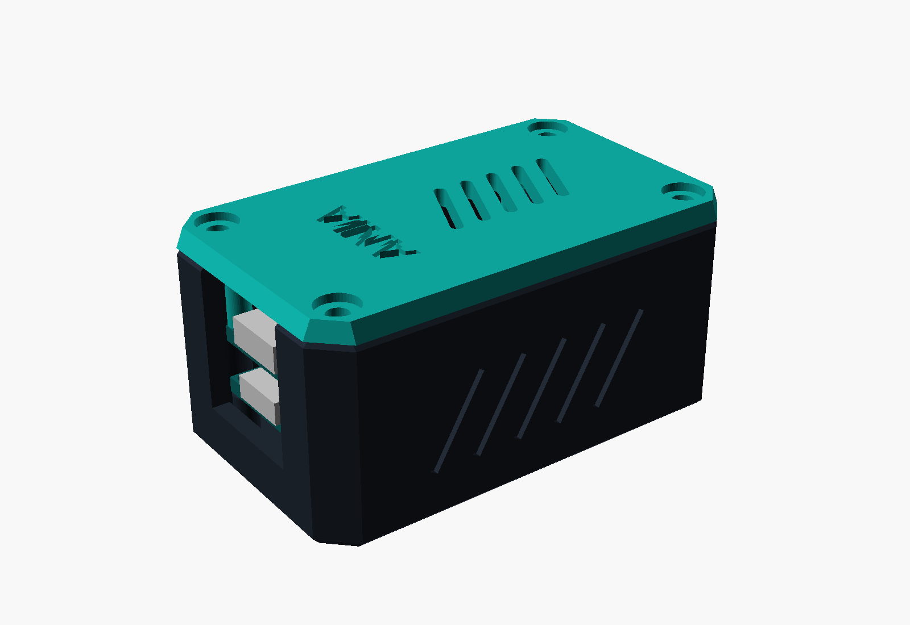
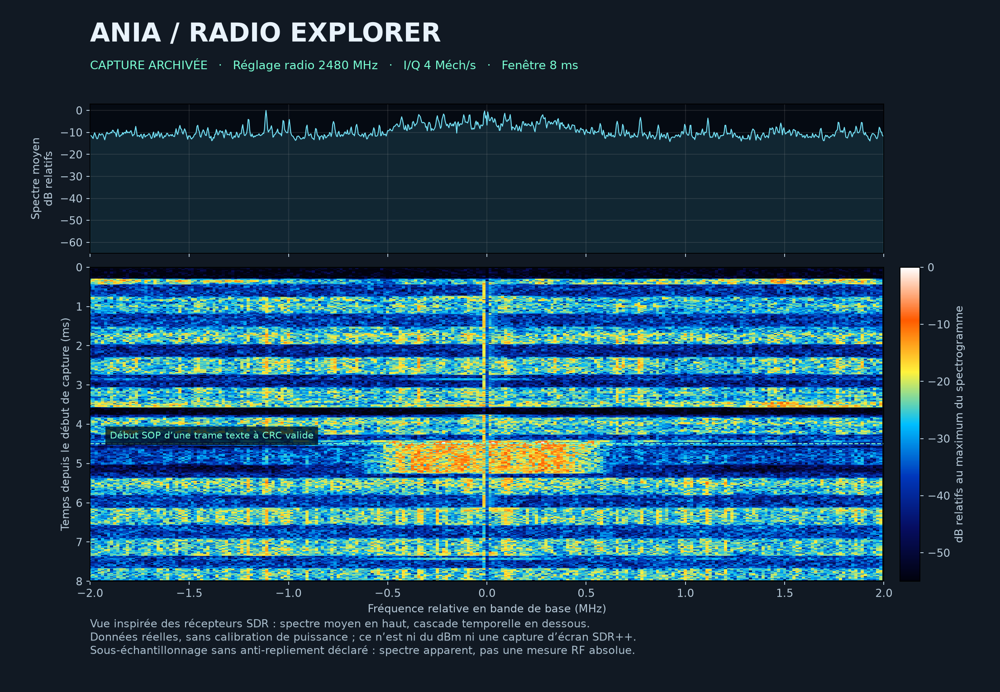
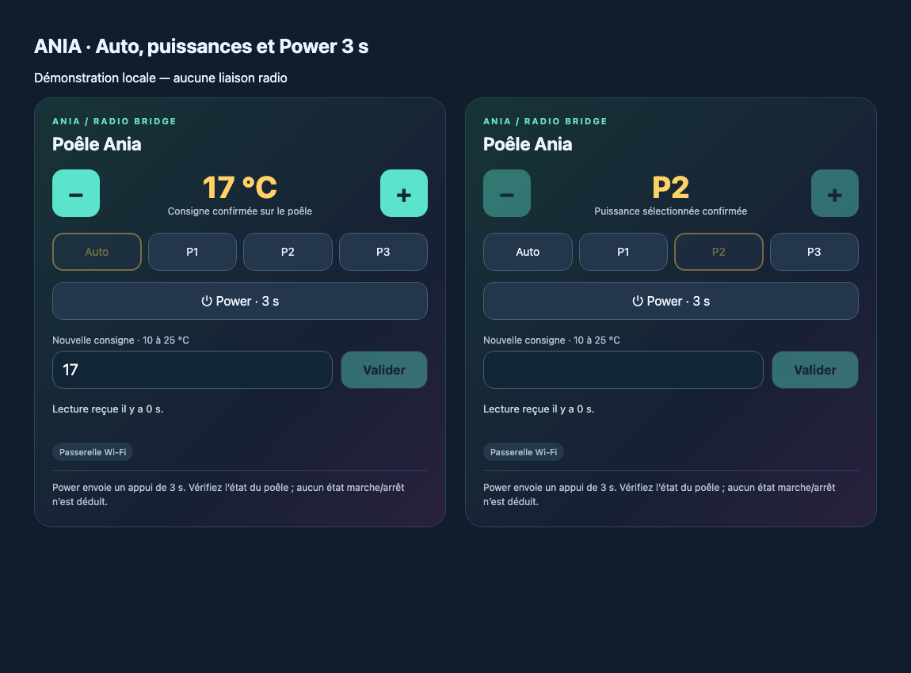

# ANIA · Radio Bridge

> **Mise à jour du 15 novembre 2026 :** liaison UART sans recâblage, contrôles plus rapides et reprise bornée des lectures. Mettre à jour les deux firmwares ensemble. [Détails et limites des essais](docs/UPDATE_UART.md). La fiabilité complète de P1/P2/P3 reste à confirmer.

  

**Une passerelle radio expérimentale pour piloter la consigne, les modes et la touche Power d’un Edilkamin Ania depuis Home Assistant.**

Deux Arduino Nano empilées, une liaison Wi-Fi et un boîtier imprimable. Documentation en français, code source et tests inclus.

> **Prototype validé sur une seule installation.** Le profil radio fourni provient de cette télécommande : il ne constitue pas un appairage universel. Ne pas flasher en supposant une compatibilité avec tous les poêles Edilkamin. Le boîtier est vérifié numériquement, pas encore imprimé et ajusté physiquement.

## Fonctions

| Fonction | État |
|---|---|
| Lecture de la consigne avec confirmation radio | Implémentée et testée |
| Boutons + et − | Implémentés et testés |
| Saisie d’une consigne de 10 à 25 °C | Séquence de pas confirmés |
| Affichage de la dernière valeur et de sa fraîcheur | Implémenté |
| Auto / P1 / P2 / P3 | Commandes intégrées ; transitions radio confirmées visuellement, sélection HA conditionnée au retour frais |
| Power unique · appui radio 3 s | Démarrage déclenché et observé ; extinction par la Nano restant à valider |
| Température ambiante, état réel de combustion | **Non validés** |
| Déchiffrement du firmware Edilkamin | **Non réalisé** |

## Architecture

La Nano ESP32 utilise sa radio pour le poêle. La Nano 33 IoT assure le Wi-Fi réseau. **Un serveur reste nécessaire** ; ce projet n’est pas un appareil ESPHome autonome.

## Parcours conseillé

1. Lire [l’étude simplifiée](docs/ETUDE.md) et les limites du profil radio.
2. Vérifier [le matériel et l’empilage](docs/MATERIEL.md).
3. [Compiler les firmwares](docs/COMPILATION.md), avec ses propres identifiants.
4. [Installer la passerelle et Home Assistant](docs/INSTALLATION.md).
5. Imprimer d’abord [le gabarit du boîtier](enclosure/gabarit_essai.stl).

## Relevés radio

[Lire les relevés radio et leurs limites de mesure](docs/RELEVES_RADIO.md). Spectre et cascade calculés à partir des I/Q archivés, dans une présentation inspirée des logiciels SDR.

## Carte Home Assistant

**Carte actuelle · v8 : Auto, P1/P2/P3 et Power 3 s.**

La carte est fournie avec son package et son script : **+ / −, saisie de cible, Auto/P1/P2/P3 et Power 3 s**. [Présentation et aperçu local](docs/CARTE_HA.md).

## Dans ce dépôt

- `radio/` : firmware Zephyr ESP32-S3, décodeur et client Python.
- `nano33_gateway/` : firmware Arduino Nano 33 IoT, protocole UART.
- `server/` : API HTTP, confirmation et déduplication des commandes.
- `ha_bundle/` : package HA, script Python et carte Lovelace.
- `enclosure/` : STL, source OpenSCAD, rendus et notice.
- `tests/` : tests hors matériel ; [mesures et limites](docs/VALIDATION.md).

Composants livrés : révision firmware/service 18, protocole de liaison 13, carte HA v8. Version du dépôt : **0.2.0 expérimentale**. Voir [les essais des modes et de Power](docs/MODES_POWER.md).

## Fiabilité

Une demande de température n’est jamais présentée comme une mesure confirmée. Les commandes relatives ne sont pas répétées aveuglément après une coupure. Les réponses sont contrôlées par CRC et consensus ; une séquence s’arrête en cas d’incertitude.

La qualité de réception et le placement restent déterminants. Des changements ont été confirmés en environ 3 secondes, mais ce n’est pas une garantie de délai. Les erreurs radio résiduelles ne sont pas éliminées.

## Licence et crédits

Code original sous **GPL-3.0-or-later** ; voir [LICENSE](LICENSE) et [crédits](THIRD_PARTY.md). Projet indépendant, sans affiliation ni validation officielle d’Edilkamin ou d’Arduino. Aucun firmware propriétaire Edilkamin, mot de passe réseau ou jeton de l’installation n’est distribué.

## Documentation détaillée

[API](docs/API.md) · [Validation](docs/VALIDATION.md) · [Contribuer](CONTRIBUTING.md) · [Sécurité](SECURITY.md) · [Historique](CHANGELOG.md)
