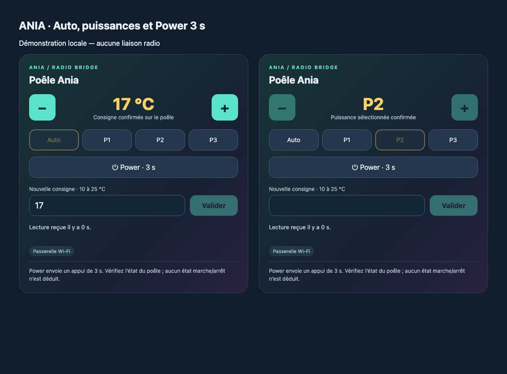

# Carte Home Assistant

La carte est incluse dans le dépôt : [JavaScript](../ha_bundle/www/ania-remote.js), [package YAML](../ha_bundle/packages/ania.yaml), [script de liaison](../ha_bundle/scripts/ania_ha.py).



**Cet aperçu utilise le véritable composant JavaScript, avec des données fictives.** Ce n’est pas une capture de l’installation personnelle et aucune commande n’est envoyée.

## Fonctions de l’interface

- Consigne observée sur le poêle, distincte de la cible saisie.
- Boutons + et − pour un degré à la fois.
- Champ « Nouvelle consigne » de 10 à 25 °C, validation par bouton ou Entrée.
- Indication de fraîcheur et suivi de la demande.
- Dernière valeur conservée, mais commandes suspendues si la liaison n’est plus confirmée.

Depuis la version 0.2.0, Auto/P1/P2/P3 et Power 3 s sont intégrés ; les limites de confirmation sont décrites ci-dessous.

## Installation

Suivre [le guide complet](INSTALLATION.md), puis ajouter :

```yaml
type: custom:ania-remote
entity: sensor.ania_consigne
enable_commands: true
max_age_seconds: 90
```

N’activer les commandes qu’après vérification de la liaison et du profil du poêle. Pour commencer en lecture seule, mettre `enable_commands: false`.

## Aperçu local sans HA

Depuis la racine du dépôt :

```sh
python3 -m http.server 8765 --bind 127.0.0.1
```

Ouvrir `http://127.0.0.1:8765/docs/ha_preview.html`. La page montre côte à côte un état confirmé et un état périmé. Les actions sont simulées et ne peuvent joindre ni HA ni le poêle.

Pour régénérer la capture, garder ce serveur ouvert, puis dans un autre terminal :

```sh
npm install --no-save playwright
npx playwright install chromium
node scripts/screenshot_ha.cjs
```

Le script vérifie les boutons activés pour l’état confirmé et désactivés pour l’état périmé avant d’enregistrer l’image. Cela ne remplace pas un essai dans Home Assistant.

## Carte v8 : modes et Power

Auto/P1/P2/P3 sont proposés lorsque le retour radio est frais et exploitable. Power · 3 s est une action manuelle unique : cliquer lance les trois secondes radio, puis le relâchement. Un délai de 60 s sépare deux demandes. L’état allumé/éteint n’est pas déduit de la réussite de l’émission. Voir [les résultats et limites](MODES_POWER.md).

Après mise à jour, recharger les scripts, Shell Command, entités de ligne de commande et modèles dans HA. La ressource doit être `/local/ania-remote.js?v=8`. Rafraîchir ensuite la page ; ne pas charger deux versions du composant simultanément.
