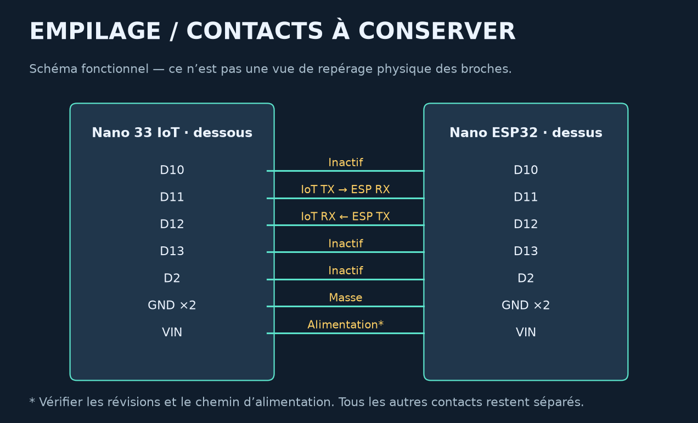
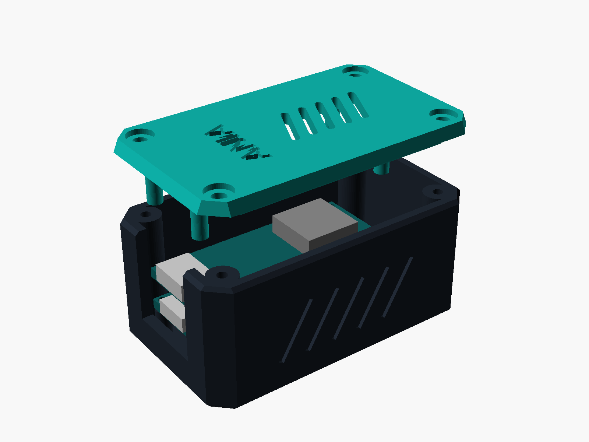

# Matériel et empilage

- Arduino **Nano ESP32**, ESP32-S3, USB-C, carte supérieure.
- Arduino **Nano 33 IoT**, SAMD21 + NINA-W102, micro-USB, carte inférieure.
- Barrettes découpées : seuls les contacts indiqués ci-dessous sont reliés.

Les deux cartes ont leurs composants dans le même sens et leurs USB du même côté. Mesure de référence : **7 mm entre faces supérieures**, environ **5 mm de vide** entre la face supérieure IoT et le dessous ESP32.

| Contact commun | Rôle | GPIO ESP32 |
|---|---|---|
| D10 | Inactif, connexion existante conservée | 21 |
| D11 | TX IoT → RX ESP32 (UART) | 38 |
| D12 | RX IoT ← TX ESP32 (UART) | 47 |
| D13 | Inactif, connexion existante conservée | 48 |
| D2 | Inactif, connexion existante conservée | 5 |
| GND × 2 | Masse commune | — |
| VIN | Alimentation commune du montage étudié | — |

Aucun fil croisé. **Ne pas relier tous les contacts** : notamment 3V3, RESET, AREF et VUSB/5V restent séparés. Les signaux sont en logique 3,3 V.

Le montage de référence fonctionne avec une alimentation USB-C commune. Avant reproduction, vérifier les révisions exactes, le chemin d’alimentation et les diodes sur les schémas officiels ; ne pas confondre VIN avec une sortie USB 5 V universelle. Ne pas alimenter les deux USB simultanément sans avoir vérifié les risques de retour d’alimentation. Pour programmer séparément une carte, travailler sur un montage dont l’alimentation est maîtrisée.

Sources des dimensions : [Nano ESP32](https://docs.arduino.cc/resources/datasheets/ABX00083-datasheet.pdf), [Nano 33 IoT](https://docs.arduino.cc/resources/datasheets/ABX00027-datasheet.pdf). Ces deux modèles ne sont pas interchangeables.

## Boîtier

Dimensions extérieures : environ **60 × 36 × 28,4 mm**. Source paramétrique : `enclosure/ania_dual.scad`. Fichiers imprimables : `socle.stl`, `couvercle.stl`, `gabarit_essai.stl`.

Imprimer le gabarit avant les pièces complètes. Il vérifie surtout l’assise et les dégagements inférieurs, pas tous les connecteurs et câbles. Suivre `enclosure/NOTICE_FR.txt` pour l’orientation, les vis et les réglages proposés. Les deux ports USB restent accessibles par une ouverture commune.

Boîtier non encore validé physiquement. Utiliser un plastique non conducteur, éloigner de la chaleur du poêle et vérifier la portée radio après fermeture.
