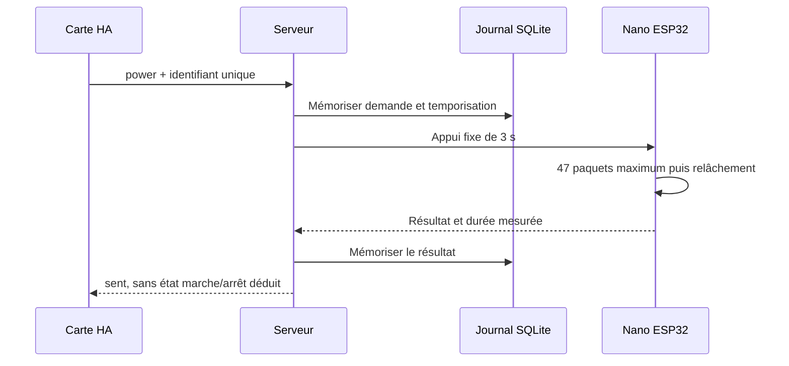

# Modes et Power : commandes et preuves

## Utilisation dans HA

La carte fournit Auto, P1, P2, P3 et **Power · 3 s**. Un clic sur Power déclenche l’appui radio complet pendant trois secondes puis le relâchement ; il n’est pas nécessaire de maintenir le doigt sur le bouton. C’est une touche de bascule, pas deux commandes absolues « on » et « off ». L’utilisateur indique que l’allumage et l’extinction utilisent tous deux ce maintien.

Le résultat « envoyé » confirme la séquence radio terminée, pas l’état physique du poêle. Aucun interrupteur HA ne prétend connaître marche/arrêt. Vérifier le poêle après Power. Une temporisation de 60 secondes empêche les doubles envois : firmware, serveur et carte la contrôlent ; le serveur la conserve dans SQLite après un redémarrage. Une perte de réponse n’entraîne aucune répétition.

Les boutons de puissance et de température nécessitent un état frais confirmé. À l’arrêt, les réponses heure/entretien/réserve ne suffisent pas : la sélection automatique de puissance peut rester indisponible. Power reste accessible comme touche manuelle explicite, sans déduire l’état courant.

## Essais du 14 novembre 2026

| Essai | Observation | Limite |
|---|---|---|
| M depuis la Nano | Manuel/P1 vu par l’utilisateur | Réveil séparé de la télécommande |
| A depuis la Nano | Auto 17 °C vu par l’utilisateur | Retour radio parfois incomplet |
| M puis +, intervalle 1 s | P2 puis P3 vus | Les changements visuels ne garantissent pas le consensus HA |
| Power bref, relâchement après 100 ms | Un bip | Aucun démarrage observé |
| Power 3 000 ms, 47 paquets, cadence 64 ms | Début de la séquence d’allumage confirmé par l’utilisateur | Ni flamme ni chauffe validées |
| Retour après Power 3 s | `TEST    PASCAL`, puis écrans réserve | Observation de cette installation, pas un décodeur général marche/arrêt |
| Arrêt final | Utilisateur remet OFF faute de pellets | Pas un essai d’extinction commandé par la Nano |

**L’extinction par Power Nano reste à vérifier**, même si la même touche et la même durée sont intégrées à la demande de l’utilisateur. Le poêle n’a pas été redémarré pour valider la nouvelle interface HA.

## Trames du profil de référence

| Touche | Trame avec longueur et CRC |
|---|---|
| M | `071234882217c87eae53` |
| A | `071234822817c87d758b` |
| Power | `071234812b18c87e41cd` |
| Relâchement Power synthétique | `07123400aa18c87e55ef` |

Les deux paquets Power de la capture initiale étaient espacés de 63,577 ms. La répétition à 64 ms pendant trois secondes a déclenché le démarrage lors de l’essai. Le relâchement est construit avec le code neutre ; ce paquet exact n’avait pas été capturé après Power. Les ondes générées se redécodent hors ligne avec CRC correct. Aucun déchiffrement du firmware propriétaire n’a été nécessaire.

## Correction du transport

`lput` écrit exactement quatre octets pour un entier 32 bits. Une version intermédiaire écrivait six octets et pouvait dépasser la fin de la trame au CRC. Le test avec octets sentinelles, les contrôles CRC et les tests anti-duplication vérifient ce correctif. Aucun gain chiffré de réception radio n’est revendiqué.

## Reproduction

Compiler les deux cartes selon [COMPILATION.md](COMPILATION.md). Les formes d’onde M/A et Power sont livrées dans `radio/src/` ; `scripts/generate_modes.py` et `scripts/generate_power.py` permettent de les régénérer et de les redécoder hors ligne. Les tests de service simulent le matériel : déduplication, redémarrage, temporisation persistante, refus des commandes absolues on/off et erreurs sans répétition.

Ne pas appeler Power depuis une automatisation de reprise après perte de liaison. Le profil radio n’est pas universel : il est propre à l’installation étudiée.

## Chaîne de traitement Power

L’intégration HA installée a également journalisé un envoi de 3 000 ms avec relâchement, et la lecture radio a confirmé `OFF 2`, puis `OFF 1`. Cela vérifie le chemin HA → serveur → Nano et la lecture du décompte. Sans observation du passage d’un état initial connu à l’extinction, ce constat ne suffit pas à attribuer l’arrêt à cette commande.
