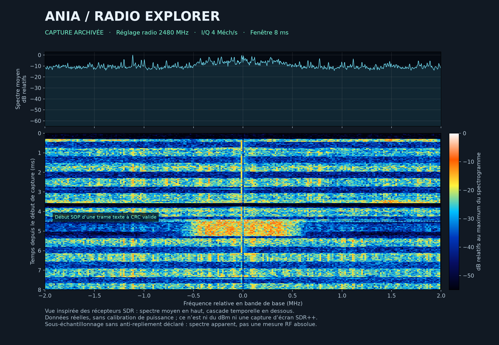
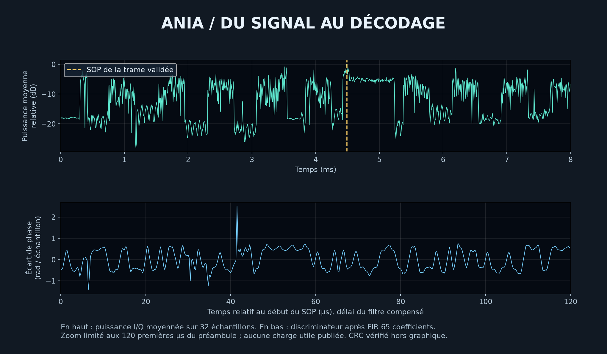

# Relevés radio — spectre et cascade

La présentation reprend le principe des logiciels SDR : **spectre en haut, cascade temps/fréquence en dessous**. Les images sont calculées à partir d’une capture I/Q réelle archivée du projet, pas dessinées pour illustrer un signal idéal et pas issues de SDR++.



## Lecture de la capture

| Paramètre | Valeur |
|---|---|
| Contexte | Réception après interrogation neutre du poêle |
| Réglage radio | 2480 MHz |
| Échantillonnage enregistré | 4 millions de paires I/Q par seconde |
| Taille | 32 000 paires, soit 8 ms |
| Quantification de la source | 8 bits, stockée dans un conteneur int16 |
| Discontinuités signalées | Aucune, un seul segment |
| Trame texte retrouvée | Une, contrôle CRC valide |
| Début du SOP décodé | Environ 4,493 ms |

Le trait pointillé situe le début du préambule retrouvé par le décodeur. La zone d’énergie centrale qui suit correspond temporellement à la trame décodée. Les autres bandes et pics ne sont **pas identifiés automatiquement comme des trames du poêle** : le contexte et le contrôle d’intégrité sont nécessaires pour cette attribution.

La cascade se lit de haut en bas : le temps augmente vers le bas. La couleur représente un niveau spectral relatif. Le spectre supérieur est moyenné sur l’ensemble des 8 ms ; il ne représente pas uniquement la trame.

## Zoom temporel



La courbe supérieure montre la puissance I/Q moyennée par blocs de 32 échantillons, normalisée à son maximum. La courbe inférieure montre les variations de phase après filtrage FIR sur les 120 premières microsecondes du préambule. Le retard de groupe de 32 échantillons du filtre est compensé dans le repérage temporel.

Il ne s’agit pas d’une preuve autonome du type exact de modulation. L’étude exploite le discriminateur, les motifs de synchronisation, le codage et le CRC ensemble.

## Limites de mesure

- Les niveaux sont des **dB relatifs**, pas des dBm : la chaîne n’est pas calibrée.
- L’axe fréquentiel est relatif à la bande de base. Il n’est pas converti en fréquence RF absolue.
- La capture indique un sous-échantillonnage sans filtre anti-repliement : les spectres sont apparents et peuvent contenir des alias.
- Cette capture historique provient de la phase v12. Son temps de transfert n’est pas celui du firmware compact v13 actuel.
- Une seule trame dans cette fenêtre ne permet pas d’estimer un taux global de réception ou la portée.

## Reproduire les figures

Les données **dérivées** sont fournies dans `docs/data/radio_plot_data.npz` et les paramètres dans `radio_capture_metadata.json`. Aucune charge utile, adresse ni date personnelle n’est exportée. Les I/Q bruts restent hors du dépôt.

```sh
pip install numpy matplotlib
python scripts/render_radio.py
```

Pour refaire l’extraction sur une capture locale au format du projet, avec son fichier JSON associé :

```sh
pip install -r requirements.txt
python scripts/extract_radio_figures.py /chemin/capture.cs16
python scripts/render_radio.py
```

Le script exige un segment continu et une trame texte avec CRC valide. Il remplace les données des figures : vérifier les métadonnées et adapter les limites/annotations du rendu si la durée, le débit ou le contexte de la nouvelle capture diffèrent. Le rendu livré est configuré pour cette fenêtre de 8 ms à 4 Méch/s.
