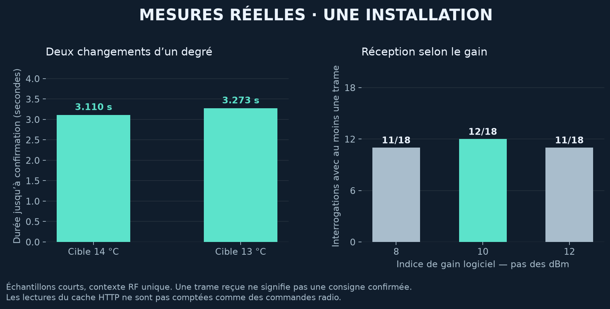

# Validation et limites

## Résultats historiques sur l’installation de référence

- Comparaison du décodeur C et du décodeur Python : 168 captures, 119 trames, correspondance exacte.
- 100 captures de bruit synthétique déterministe : aucune trame acceptée.
- Deux changements de consigne par l’API : 3,110 s et 3,273 s.
- Une courte série après correction du cache : 12 lectures fraîches sur 12, réponse API maximale 0,031 s. Il s’agit de lectures du cache confirmé, **pas de douze échanges radio instantanés**.
- D’autres essais ont connu des délais de 6–9 s et des échecs. Les taux ci-dessus ne constituent pas une mesure de disponibilité à long terme.

Les captures privées complètes ne sont pas distribuées : la comparaison des 168 captures est un résultat historique, pas un test reproductible à partir de ce dépôt seul. Les tests synthétiques et unitaires du dépôt sont exécutables sans poêle. Ils ne remplacent pas une validation RF sur une nouvelle installation.

## Exécuter les tests

```sh
python3 -m venv .venv
. .venv/bin/activate
pip install -r requirements.txt
python -m unittest discover -s radio -p 'test_*.py'
python -m unittest discover -s tests -p 'test_*.py'
node tests/test_card.js
node tests/test_card_stale.cjs
cc -Wall -Wextra tests/test_wire.c -o /tmp/ania-wire-test
/tmp/ania-wire-test
```

Les tests de la carte HA portent sur sa logique, pas sur un navigateur complet. Les fichiers STL sont fermés, orientés et chacun d’un seul tenant selon `enclosure/validation.json`. Cette validation géométrique ne garantit pas l’ajustement imprimé.

## Graphiques reproductibles



Les tableaux anonymisés dans `docs/data/` proviennent des essais de gain (54 interrogations, 18 par indice) et de trois séquences cibles (dont une sans changement). Le graphique ne trace que les deux changements effectifs. Aucun identifiant de requête ni horodatage personnel n’est conservé.

Régénération : `pip install matplotlib numpy`, puis `python scripts/render_figures.py`. Les données représentent ces essais précis, sans extrapolation statistique.

## Contrôles de la distribution initiale

Les sources préparées pour GitHub ont été recompilées : Nano ESP32 (Zephyr, chaîne et modules locaux épinglés) et Nano 33 IoT (identifiants factices). Aucun flash ni essai sur le poêle n’a été effectué pour cette publication. 29 tests radio Python et 30 tests service/transport/HA passent, ainsi que les contrôles JavaScript et C du protocole. Un clonage complet des dépendances sur une machine vierge n’a pas été exécuté.

## Extension modes et Power (0.2.0)

Voir [le journal synthétique des essais](MODES_POWER.md). Les validations précédentes restent historiques. Le démarrage par maintien Power de trois secondes est observé ; l’extinction par la Nano et un état physique marche/arrêt automatique restent non validés.

Validation hors matériel de la distribution 0.2.0 : **83 tests Python réussis** (42 radio, 41 service/transport/helper), test C du protocole, vérifications JavaScript et test DOM local de la carte (un seul appel Power malgré un double clic, temporisation et absence d’état marche/arrêt inventé). Compilation des deux cartes et contrôle sans émission réalisés.

## Réception V25

Publication validée hors matériel : **102 tests Python réussis** (42 radio et 60 service/transport), deux contrôles JavaScript et test C du protocole. Les mesures sur le poêle et la limite de réactivité encore ouverte sont consignées dans [UPDATE_RX_V25.md](UPDATE_RX_V25.md).
